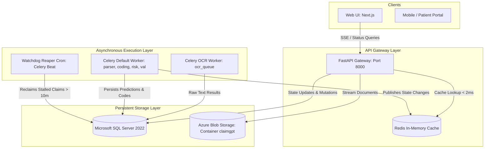

# ClaimsGuru — Comprehensive Architectural Audit & Resilience Roadmap

> **Author**: Senior Full-Stack Architect & SRE / DevOps Lead  
> **Date**: October 2026  
> **Target Scope**: End-to-End System Resiliency, Concurrency Scaling, Fault Tolerance & API Contracts

---

## Executive Summary

This document provides an in-depth architectural audit of the **ClaimsGuru** healthcare claim processing platform. It identifies systemic breaking points, edge-case failure modes under concurrent user load, container crash recovery gaps, API contract fragilities, and outlines a concrete roadmap to transition the platform into an enterprise-grade, self-healing architecture.

---

## 1. High Concurrency & Multi-User Collisions (The 100-User Breaking Points)

### 1.1 The 1-Second Polling Bomb & Database Connection Starvation

* **Code Location**: `ui/web/components/claimgpt/use-auditor-state.ts` (Line 470)
  ```typescript
  const interval = setInterval(pollAllActiveClaims, 1000);
  ```
* **Failure Mechanism**:
  * Every browser client actively polling an ongoing claim fires a `GET /ingress/claims/{claim_id}/progress` request every **1,000 milliseconds**.
  * If **50 users** each have 2 active claims undergoing processing, the API gateway is subjected to **100+ requests per second** continuously hitting FastAPI and Microsoft SQL Server.
  * In `libs/shared/db.py`, the connection pool is configured to:
    ```python
    writer_engine = create_engine(
        settings.database_url,
        pool_size=20,
        max_overflow=30,  # Hard ceiling of 50 connections
        pool_timeout=30,
        pool_recycle=300
    )
    ```
  * During peak multi-tenant load or bulk file uploads, MSSQL connection limits are rapidly exhausted, throwing:
    `sqlalchemy.exc.TimeoutError: QueuePool limit of size 20 overflow 30 reached, connection timed out`.
* **Architectural Remediation**:
  1. **Immediate (Short-Term)**: Cache the active pipeline `WorkflowState` directly in Redis with a 2–3 second TTL. Over 95% of client progress polling requests should be served from memory with sub-millisecond response times, bypassing MSSQL.
  2. **Strategic (Long-Term)**: Transition the UI from polling to **Server-Sent Events (SSE)** via `/ingress/claims/{claim_id}/events` or WebSocket. As Celery completes each pipeline task, worker signals publish step transitions via Redis Pub/Sub directly to connected clients.

---

### 1.2 Lack of Distributed Locks on Concurrent Claim Mutations

* **Code Location**: `services/ingress/app/main.py`, `services/submission/app/main.py`
* **Failure Mechanism**:
  * While the asynchronous Celery pipeline is executing (e.g., OCR or Coding), an auditor may open the claim modal and manually edit field values, ICD codes, or itemized expenses.
  * When the Celery worker completes a task, it flushes its version of `Claim.canonical_json` to the database.
  * Without distributed concurrency control, whichever process commits last silently overwrites changes made by the other (**Lost Update Anomaly**).
* **Architectural Remediation**:
  * Implement Redis distributed locks (`redlock`) or database-level row locking (`SELECT ... WITH (UPDLOCK)`) on claim mutation endpoints to ensure mutually exclusive write transactions.

---

## 2. Server Crashes, Restarts & Self-Healing (The "Zombie Claim" Problem)

### 2.1 Missing Dead Man's Switch / Reaper Cron

* **Failure Mechanism**:
  * In containerized environments (Azure Container Apps, Kubernetes, Docker Desktop), nodes occasionally restart due to auto-scaling policies, rolling deployments, or Out-Of-Memory (OOM) kills during heavy machine learning inference (e.g., PubMedBERT RAG or LayoutLM).
  * If a worker is terminated mid-task (for instance, while executing `CODING_ANALYSIS` at 60%):
    1. The worker process exits abruptly.
    2. Celery re-queues tasks if `task_reject_on_worker_lost=True`, but if the task hits its maximum retry ceiling or suffers a unrecoverable SIGKILL, the task terminates permanently.
    3. The database record in `WorkflowState` remains indefinitely as:
       `status = 'RUNNING', current_step = 'CODING_ANALYSIS', percentage = 60`.
    4. The UI continues to poll this claim forever, stranding the user on the *"AI Medical Engine Analyzing..."* animation with zero recovery options.
* **Architectural Remediation**:
  * **Automated Reaper Cron**: A scheduled background Celery Beat job running every 3–5 minutes:
    ```python
    # Reaper Task Query
    stalled_claims = db.query(WorkflowState).filter(
        WorkflowState.status == "RUNNING",
        WorkflowState.updated_at < datetime.now(timezone.utc) - timedelta(minutes=10)
    ).all()
    for state in stalled_claims:
        state.status = "FAILED"
        state.current_step = "TIMED_OUT"
        # Auto-dispatch dead-letter alert or retry trigger
    ```
  * **Client-Side Graceful Failover**: If a claim's step progress remains unchanged for $> 5$ minutes, display a prominent **"Pipeline Stalled — [Restart AI Analysis]"** prompt rather than indefinite loading.

---

## 3. API Architecture & Data Contracts: Monolith vs "Patch Work"

### 3.1 The 4,600-Line Monolithic Anti-Pattern

* **Code Location**: `services/ingress/app/main.py` (4,628 lines)
* **Architectural Flaw**:
  * A single mega-module houses:
    * Authentication, password hashing, and Entra ID JWT verification.
    * Document intake, file validation, and Azure Blob storage streaming.
    * Celery pipeline orchestration and inline execution fallbacks.
    * Multi-tenant organization invitations and staff role management.
    * Claim query endpoints, notification polling, and TPA routing.
  * Merging multiple business domains into one file introduces high cognitive overhead, circular import risks, and severe regression vulnerability.
* **Architectural Remediation**:
  * Decompose into domain-driven sub-routers:
    * `services/ingress/app/routers/auth.py`
    * `services/ingress/app/routers/claims.py`
    * `services/ingress/app/routers/documents.py`
    * `services/ingress/app/routers/organizations.py`
    * `services/ingress/app/routers/workflow.py`

---

### 3.2 Defensive Multi-Alias Fallbacks Across UI & Backend

* **Code Location**: `ui/web/lib/api-client.ts`, `ui/web/components/claimgpt/use-auditor-state.ts`
  ```typescript
  const patient_name = pf.patient_name || pf.member_name || pf.insured_name || summary.patient_name || "Valued Patient";
  const claim_amt = pf.total_amount || pf.billed_amount || pf.net_amount || pf.claim_amount || pf.claimed_total || 0;
  ```
* **Architectural Flaw**:
  * The backend returns loosely-typed dictionary blobs whose keys vary depending on whether the parser extracted data via regex, heuristics, or LLM.
  * The frontend is forced to write defensive fallback chains across dozens of components. If a backend developer alters an extraction key, downstream UI views silently degrade.
* **Architectural Remediation**:
  * Enforce a strict **Canonical Pydantic Response Model** (`CanonicalClaimPreviewResponse`) on `/submission/claims/{id}/preview`.
  * The backend must perform alias normalization *before* serialization so the frontend consumes uniform, strongly-typed JSON properties.

---

## 4. Frontend Edge Cases & Performance Fragility

| Vector | Current Failure Mode | Architectural Solution |
| :--- | :--- | :--- |
| **Concurrent Interval Timers** | 4 uncoordinated `setInterval` loops run concurrently (1s, 1.5s, 8s, 15s). Inactive browser tabs continue bombarding the API gateway. | Integrate `document.visibilityState` to suspend polling when the browser tab is blurred; unify polling into a centralized hook. |
| **High Expense Item Volume** | Claims containing 100+ line items cause DOM lag and layout reflow in `claim-report-modal.tsx`. | Implement virtualized table lists using `@tanstack/react-virtual`. |
| **Crash Boundaries** | If a backend response sends `expenses: null` or an unexpected object structure, React throws an uncaught TypeError, causing a complete white-screen crash. | Wrap modal views and report panels in a React `<ErrorBoundary fallback={<AuditCrashFallback />} />`. |

---

## 5. System Target Architecture



---

## 6. Priority Implementation Roadmap

1. **Phase 1: Resilience & Connection Stability [COMPLETED]**
   * [x] **Redis Caching**: Active pipeline queries cached with 3–5s TTL, completed/failed claims cached with 300s TTL.
   * [x] **Zombie / Stalled Detection**: $>5$ min worker inactivity automatically transitions `WorkflowState` to `status: "STALLED"`, `is_stalled: true`, `can_retry: true`.
   * [x] **Graceful UI Recovery**: Polling halts endless spinner; displays amber **"Pipeline Stalled"** badge with a one-click **"Restart AI Analysis"** button (`RotateCcw`).
   * [x] **Seamless Reprocessing**: `POST /claims/{claim_id}/retry` and `/reprocess` invalidates Redis cache and immediately re-enqueues OCR and downstream stages without requiring document re-upload.
2. **Phase 2: API Contract Hardening**
   * Refactor `/submission/claims/{id}/preview` to return a strictly validated Pydantic model.
   * Eliminate defensive multi-alias chains across the frontend codebase.
3. **Phase 3: Codebase Modularization**
   * Refactor `services/ingress/app/main.py` into domain routers (`routers/auth.py`, `routers/claims.py`, `routers/documents.py`).
   * Wrap high-complexity UI modals in React Error Boundaries with graceful fallbacks.
4. **Phase 4: Real-Time Event Streaming**
   * Implement Server-Sent Events (SSE) to replace 1-second polling completely.
