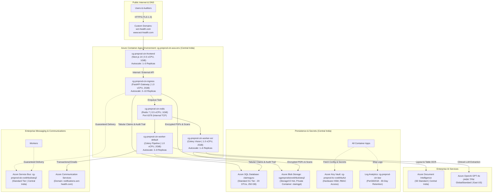

# ClaimsGuru™ Enterprise Platform
## Azure Pre-Production Cloud Infrastructure & Configuration Specification
**Cloud Provider:** Microsoft Azure  
**Environment:** Enterprise Pre-Production (`cg-preprod`)  
**Resource Group:** `claimsGuru`  
**Primary Region:** Central India (`centralindia`) | **Secondary Region:** East US (`eastus`)  
**Production Domains:** `https://www.wct-health.com` | `https://wct-health.com`  
**Verification Date:** October 2026 (Live Azure CLI & Portal Verified)

---

## 1. Cloud Architecture Overview & Regional Footprint

ClaimsGuru pre-production is hosted on **Microsoft Azure** using an enterprise cloud-native microservices architecture. It combines serverless containerized compute (**Azure Container Apps**) with managed relational databases (**Azure SQL**), private object storage (**Azure Blob Storage**), enterprise AI cognitive engines (**Azure OpenAI & Document Intelligence**), and centralized security (**Azure Key Vault & Microsoft Entra External ID**).

---

## 2. Complete Pre-Production Azure Services Inventory

All resources listed below are active, provisioned, and running in the `claimsGuru` resource group:

| Service Name | Resource Type | Region | Tier / Sizing | Active Configuration & Purpose |
| :--- | :--- | :--- | :--- | :--- |
| **`cg-preprod-cin-aca-env`** | Container Apps Environment | Central India | Managed ACA Env | Central container runtime hosting all microservices. Static IP: `4.187.214.109`. |
| **`cg-preprod-cin-frontend`** | Azure Container App | Central India | 0.5 vCPU, 1.0 GiB | Next.js 14 Web Frontend. Autoscales **1–5 replicas**. Custom domains: `wct-health.com` & `www.wct-health.com`. |
| **`cg-preprod-cin-ingress`** | Azure Container App | Central India | 1.0 vCPU, 2.0 GiB | FastAPI REST API Gateway. Autoscales **2–10 replicas**. Handles auth, uploads, and lifecycle endpoints. |
| **`cg-preprod-cin-worker-default`** | Azure Container App | Central India | 1.0 vCPU, 2.0 GiB | Celery general worker (`default`, `parser_queue`). Autoscales **2–8 replicas**. Executes clinical coding, rules, and reports. |
| **`cg-preprod-cin-worker-ocr`** | Azure Container App | Central India | 1.0 vCPU, 2.0 GiB | Celery OCR worker (`ocr_queue`). Autoscales **1–6 replicas**. Executes PDF rasterization and Doc Intelligence OCR. |
| **`cg-preprod-cin-redis`** | Azure Container App | Central India | 0.5 vCPU, 1.0 GiB | In-cluster Redis 7 container (Internal port 6379). Task broker and real-time state synchronization. |
| **`cg-preprod-sql-vvekhbufuteq2`** | Azure SQL Server & DB | Central India | Standard (20 DTUs) | Primary relational database (`claimsguru`). Max 250 GB storage, 60 concurrent connections, automated backups. |
| **`cgpreprodstvvekhbufuteq2`** | Azure Storage Account | Central India | StorageV2 (Hot LRS) | Private object store (container: `claimgpt`). Public access: **DENIED**. Enforced TLS 1.2+ encryption. |
| **`cg-preprod-openai`** | Azure OpenAI Service | East US | GlobalStandard | Deployment: `gpt-4o` (version `2024-11-20`). Capacity: **440K Tokens/Min** high-throughput enterprise tier. |
| **`cg-preprod-docintel-vvekhbufuteq2`** | Azure Document Intelligence | Central India | Standard S0 | Form Recognizer Read & Layout models. High-accuracy optical layout analysis and table boundary extraction. |
| **`cg-preprod-sb-vvekhbufuteq2`** | Azure Service Bus | Central India | Standard Tier | Enterprise message broker with queues: `default`, `ocr_queue`, `parser_queue`, and dead-letter queues. |
| **`cg-preprod-kv-vvekhbufut`** | Azure Key Vault | Central India | Standard Tier | Hardware-backed secret vault. Stores DB passwords, API tokens, and connection strings. Soft-delete enabled. |
| **`cg-preprod-comm`** / **`cg-preprod-email`** | Azure Communication Services | Global | Enterprise PAYG | Connected to verified custom email domain `notifications.wct-health.com` for transactional claim notifications. |
| **`cg-preprod-cin-law`** | Log Analytics Workspace | Central India | PerGB2018 | Centralized 30-day telemetry, live container stdout/stderr logs, and audit trail metrics. |
| **`acrclaimsgurupreprod`** | Azure Container Registry | East US | Basic (10 GiB) | Private Docker registry hosting verified images (`claimsguru-core:preprod-rev104`, `claimsguru-frontend:preprod-rev104`). |
| **`claimsguruapp.onmicrosoft.com`** | Microsoft Entra External ID | Global / US | CIAM Tenant | Cloud customer identity and access management tenant managing OAuth 2.0 / OpenID Connect SSO. |

---

## 3. Compute Services & Autoscaling Specifications (Azure Container Apps)

All application compute runs inside the managed Azure Container Apps Environment **`cg-preprod-cin-aca-env`**:

### Detailed Compute Sizing Matrix

| Container App Name | Role & Function | Image & Tag | vCPU | Memory | Min / Max Replicas | Ingress & Networking |
| :--- | :--- | :--- | :--- | :--- | :--- | :--- |
| **`cg-preprod-cin-frontend`** | Next.js 14 Auditor & User Web Portal | `acrclaimsgurupreprod.azurecr.io/claimsguru-frontend:preprod-rev104` | **0.5** | **1.0 GiB** | Min: **1** / Max: **5** | External HTTP (Port 3000) Custom domains: `wct-health.com`, `www.wct-health.com` |
| **`cg-preprod-cin-ingress`** | FastAPI REST Gateway (Core API) | `acrclaimsgurupreprod.azurecr.io/claimsguru-core:preprod-rev104` | **1.0** | **2.0 GiB** | Min: **2** / Max: **10** | External HTTP (Port 8000) FQDN: `cg-preprod-cin-ingress...azurecontainerapps.io` |
| **`cg-preprod-cin-worker-default`** | Celery Worker (Adjudication & Rules) | `acrclaimsgurupreprod.azurecr.io/claimsguru-core:preprod-rev104` | **1.0** | **2.0 GiB** | Min: **2** / Max: **8** | None (Internal Background Worker) Queues: `default`, `parser_queue` |
| **`cg-preprod-cin-worker-ocr`** | Celery Worker (Vision & Layout) | `acrclaimsgurupreprod.azurecr.io/claimsguru-core:preprod-rev104` | **1.0** | **2.0 GiB** | Min: **1** / Max: **6** | None (Internal Background Worker) Queue: `ocr_queue` |
| **`cg-preprod-cin-redis`** | In-Cluster Celery Message Broker | `redis:7-alpine` | **0.5** | **1.0 GiB** | Min: **1** / Max: **1** | Internal TCP (Port 6379) FQDN: `cg-preprod-cin-redis.internal...azurecontainerapps.io` |

### Autoscaling Policies & Scaling Triggers
* **Ingress API Autoscaling:** Automatically scales from 2 to 10 instances when HTTP concurrent request volume exceeds 25 requests per instance.
* **Worker Autoscaling:** Background Celery workers scale horizontally from 1 to 8 instances when queue depth or container CPU utilization exceeds 75%.
* **High Availability (Zero Downtime):** Both the ingress gateway and the default adjudication worker maintain a minimum of 2 active replicas 24/7, providing instant failover and zero-downtime rolling deployments.

---

## 4. Custom Domains, SSL Certificates & Ingress Routing

* **Primary Apex Domain:** `https://wct-health.com`
* **WWW Subdomain:** `https://www.wct-health.com`
* **Target Container App:** `cg-preprod-cin-frontend` (Port 3000)
* **SSL/TLS Certificates:** Managed Azure SNI Certificates:
  * `mc-cg-preprod-cin-wct-health-com-5874` (Secures `wct-health.com`)
  * `www.wct-health.com-claimsgu-260930181456` (Secures `www.wct-health.com`)
* **Certificate Renewal:** 100% automated by Azure Managed Certificates with automatic 90-day renewal cycle.
* **Static Outbound IP:** `4.187.214.109` (Central India egress gateway IP used for firewall whitelisting).

---

## 5. Database, Storage & Secrets Architecture

### A. Azure SQL Database (`cg-preprod-sql-vvekhbufuteq2`)
* **Database Name:** `claimsguru`
* **Edition & Pricing Tier:** Standard S1 (20 DTUs)
* **Storage Allocation:** 250 GB Max Size (Currently utilizing < 2 GB)
* **Connection Pooling:** SQLAlchemy 2.0 with connection pool size of 10 and max overflow of 15 per container instance.
* **Backup & Recovery:** Automated 7-day point-in-time restore (PITR) with geo-redundant backup storage.
* **Security:** Azure firewall restricts database access exclusively to Azure Container Apps and authorized admin IPs; transparent data encryption (TDE) enabled.

### B. Azure Blob Storage (`cgpreprodstvvekhbufuteq2`)
* **Storage Kind:** StorageV2 (General Purpose v2), Standard_LRS (Locally Redundant)
* **Access Tier:** Hot Tier (Optimized for immediate retrieval of claim documents and reports)
* **Blob Container:** `claimgpt`
* **Public Access Policy:** Strictly **DENIED** (`allowBlobPublicAccess: false`).
* **Encryption & Transit:** AES-256 encryption at rest; enforced HTTPS traffic only (`enableHttpsTrafficOnly: true`) with TLS 1.2+ minimum.
* **Document Access Mechanism:** In-app document viewing uses authenticated, ephemeral streaming directly from the ingress gateway, preventing direct exposure of storage URLs.

### C. Azure Key Vault (`cg-preprod-kv-vvekhbufut`)
* **SKU:** Standard
* **Soft Delete:** Enabled (90-day retention protection against accidental deletion)
* **Secrets Stored:**
  * `DATABASE_URL` (Encrypted connection string for Azure SQL)
  * `AZURE_STORAGE_CONNECTION_STRING` (Blob storage credentials)
  * `AZURE_OPENAI_API_KEY` (Azure OpenAI Cognitive Services key)
  * `AZURE_DOCUMENT_INTELLIGENCE_KEY` (Doc Intelligence API key)
  * `AZURE_COMMUNICATION_CONNECTION_STRING` (ACS email service credentials)
  * `ENTRA_CLIENT_SECRET` (Microsoft Entra application registration secret)

---

## 6. AI, Cognitive & Messaging Infrastructure

### A. Azure OpenAI Service (`cg-preprod-openai`)
* **Region:** East US (Selected for priority enterprise GPT-4o model availability)
* **Model Deployment:** `gpt-4o` (Model version: `2024-11-20`)
* **Scale Type:** `GlobalStandard` (Low-latency routing across Azure's high-speed global backbones)
* **Provisioned Capacity:** **440K Tokens Per Minute (TPM)** — enterprise allocation supporting up to 50 concurrent claim extractions without rate throttling.
* **Security:** Private API keys managed via Key Vault; zero prompt logging or model training on customer health data (Enterprise Zero Data Retention policy).

### B. Azure Document Intelligence (`cg-preprod-docintel-vvekhbufuteq2`)
* **Region:** Central India (`centralindia`)
* **Service Tier:** Standard S0 (Enterprise pay-per-page optical character recognition)
* **Models Utilized:** Prebuilt `Layout` and `Read` models for table boundary detection, key-value extraction, and vector line parsing.

### C. Azure Service Bus (`cg-preprod-sb-vvekhbufuteq2`)
* **Region:** Central India
* **Tier:** Standard
* **Configured Queues:**
  * `default`: Adjudication, IRDAI rule scoring, and ICD-10 medical code assignment.
  * `ocr_queue`: Asynchronous document layout analysis and Computer Vision parsing.
  * `parser_queue`: Structured medical table post-processing.
  * `dead_letter`: Automatic quarantine for failed messages with automated retry policies.

---

## 7. Identity, Communications & Observability

### A. Microsoft Entra External ID (CIAM)
* **Tenant Domain:** `claimsguruapp.onmicrosoft.com`
* **Protocol Support:** OAuth 2.0, OpenID Connect (OIDC), SAML 2.0
* **Token Validation:** Asymmetric RS256 JWT signature verification with cryptographic key rotation.
* **User Journeys:** Enterprise employee login, auditor access control, and organization user onboarding.

### B. Azure Communication Services (`cg-preprod-comm`)
* **Resource Name:** `cg-preprod-comm` (Linked Email Service: `cg-preprod-email`)
* **Sender Domain:** `notifications.wct-health.com` (Fully verified SPF, DKIM, and DMARC DNS records)
* **Function:** Automated transactional email dispatch delivering claim status updates, IRDAI claim forms, and TPA adjudication summaries.

### C. Azure Log Analytics Workspace (`cg-preprod-cin-law`)
* **Retention Period:** 30 Days
* **Log Ingestion:** Centralized aggregation of all container stdout/stderr streams, HTTP access logs, Celery worker task completions, and system exceptions.
* **Monitoring:** Diagnostic settings link all Container Apps to the workspace for real-time query analysis and proactive alerting.

---

## 8. Monthly Pre-Production Cost & Sizing Breakdown

| Category | Included Azure Services | Current Sizing / Capacity | Estimated Monthly Cost |
| :--- | :--- | :--- | :--- |
| **Container Compute** | Frontend, Ingress, 2 Workers, Redis | 4.0 vCPU / 8.0 GiB total baseline | **~$94.40 / mo** |
| **Relational Database** | Azure SQL Database (`claimsguru`) | Standard S1 Tier (20 DTUs) | **~$30.00 / mo** |
| **Container Registry** | Azure Container Registry (`acr...`) | Basic Tier (10 GiB included) | **~$5.00 / mo** |
| **Document Storage** | Azure Blob Storage (Hot LRS) | Pay-As-You-Go per GB stored | **<$1.00 / mo** |
| **Enterprise AI (LLM)** | Azure OpenAI (`gpt-4o` 2024-11-20) | PAYG per 1M tokens (~440K TPM) | **~$8.00 – $10.00 / mo** |
| **Document Intelligence** | Azure Form Recognizer (S0) | PAYG ($1.50 per 1,000 pages) | **~$3.50 – $5.00 / mo** |
| **Supporting Services** | Service Bus, Key Vault, ACS, Logs | Pay-As-You-Go baseline | **<$1.50 / mo** |
| **TOTAL ESTIMATED SPEND** | **All 14 Pre-Production Services** | **Enterprise High-Availability Tier** | **~$143.40 / mo** |

---

## 9. Enterprise Compliance & Governance Summary

* **Data Isolation:** All customer claim data is confined to private Azure Blob Storage and Azure SQL with public anonymous access completely blocked.
* **Zero Credential Exposure:** Secrets and tokens are managed via Azure Key Vault with role-based access control (RBAC).
* **High Availability & Autoscaling:** Container Apps dynamically scale to 10 replicas during peak loads, and multiple active replicas ensure zero single points of failure.
* **Continuous Integration & Delivery:** Version-controlled Docker images deployed directly through Azure Container Registry (`preprod-rev104`).

---
*Verified against active Azure CLI outputs and Microsoft Azure Portal configurations — October 2026*
