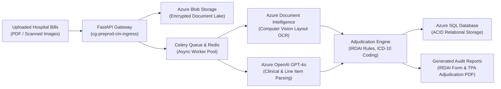
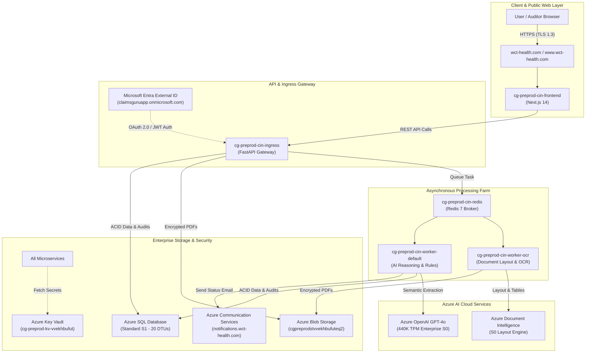

# ClaimsGuru™ Enterprise Platform
## Backend Technology Stack & Pre-Production Cloud Deployment Guide
**Target Audience:** Marketing Team, Sales Enablement, Enterprise Buyers & Executive Stakeholders  
**Cloud Environment:** Microsoft Azure Pre-Production (`claimsGuru` / Central India)  
**Production Domains:** `https://www.wct-health.com` | `https://wct-health.com`  
**Classification:** Enterprise Technical & Marketing Brief  
**Last Verified:** October 2026 (Live Azure Pre-Prod Environment)

---

## 1. Executive Summary: What Powers ClaimsGuru?

**ClaimsGuru** is an enterprise-grade AI healthcare platform designed to automate and accelerate health insurance claim adjudication. It transforms chaotic, multi-page, scanned hospital bills, diagnostic receipts, prescriptions, and discharge summaries into structured, verified, itemized financial line items and IRDAI-compliant audit reports.

Built natively on **Microsoft Azure**, ClaimsGuru replaces slow, manual claim verification with a high-throughput, microservices-driven backend. It pairs cutting-edge **Computer Vision (Azure AI Document Intelligence)** and **Enterprise Generative AI (Azure OpenAI GPT-4o)** with an asynchronous queue engine that processes massive hospital claim packages in seconds—with complete mathematical precision, zero data loss, and bank-grade privacy.

---

## 2. Core Backend Technologies & Why They Matter

Here is a breakdown of the core technologies powering ClaimsGuru, translated into simple business and marketing terms:

### A. Core Runtime & API Gateway
* **Python 3.11+ & FastAPI**:
  * *What it is:* A modern, high-performance web framework designed for asynchronous, low-latency API handling.
  * *Why we chose it:* Ensures instant response times for users uploading documents or navigating dashboards, even when hundreds of claims are being submitted simultaneously.
* **Uvicorn & uvloop**:
  * *What it is:* Enterprise-grade ASGI web server running on an ultra-fast event loop.
  * *Why we chose it:* Delivers maximum requests-per-second throughput with minimal server overhead.

### B. Asynchronous Job Queuing & Real-Time Caching
* **Celery 5.4**:
  * *What it is:* A distributed background task execution system.
  * *Why we chose it:* Heavy computational tasks—like OCR scanning 50-page hospital bills or calling AI models—are offloaded to background workers. The user's screen never freezes, and progress bars update in real time.
* **Redis 7 (In-Cluster Container)**:
  * *What it is:* Ultra-fast, in-memory key-value data store.
  * *Why we chose it:* Acts as the lightning-fast message broker for Celery queues and maintains sub-millisecond claim state synchronization for live progress tracking.
* **Azure Service Bus**:
  * *What it is:* Microsoft Azure's enterprise-grade cloud message broker.
  * *Why we chose it:* Guarantees high-reliability message delivery and dead-letter queueing between services, preventing any claim data loss during network hiccups.

### C. Generative AI, OCR & Clinical Intelligence
* **Azure OpenAI Service (GPT-4o — Version 2024-11-20)**:
  * *What it is:* Enterprise-hosted multimodal Large Language Model (LLM) running in Microsoft's private cloud.
  * *Why we chose it:* Analyzes complex, messy Indian hospital line items (pharmacy consumables, ICU tariffs, surgical charges), maps diagnosis to official ICD-10 and CPT codes, and flags non-payable items per IRDAI guidelines.
* **Azure AI Document Intelligence (Form Recognizer v3.3 / S0)**:
  * *What it is:* Advanced Computer Vision service specialized in reading tables, grids, and handwriting from scanned PDFs.
  * *Why we chose it:* Extracts complex multi-column hospital billing tables with bounding-box coordinate precision, converting blurry scans into clean tabular data.
* **FAISS Vector Index & BM25 Hybrid Search**:
  * *What it is:* High-speed semantic search engines embedded in Python.
  * *Why we chose it:* Instantly matches free-text clinical diagnoses from doctors' notes to thousands of standard medical procedure codes in milliseconds.

### D. Relational Database & Document Lake
* **Azure SQL Database (Microsoft SQL Server — Standard S1 / 20 DTUs)**:
  * *What it is:* Enterprise cloud relational database with full ACID compliance.
  * *Why we chose it:* Provides tamper-resistant, structured storage for claim metadata, itemized expenses, patient demographics, and full audit logs with point-in-time recovery.
* **Azure Blob Storage (StorageV2 - Hot Tier)**:
  * *What it is:* Scalable, highly encrypted object storage.
  * *Why we chose it:* Stores original patient PDFs and generated audit reports with strict access controls, zero public access, and AES-256 encryption.

### E. Enterprise Security, Identity & Notifications
* **Microsoft Entra External ID (CIAM / OAuth 2.0 / OIDC)**:
  * *What it is:* Microsoft’s enterprise identity service supporting Single Sign-On (SSO), Multi-Factor Authentication (MFA), and secure role-based access.
  * *Why we chose it:* Ensures only verified corporate employees and designated auditors can access claim files and adjudication cockpits.
* **Azure Key Vault**:
  * *What it is:* Cloud hardware security module (HSM) for secret storage.
  * *Why we chose it:* Secures all database credentials, AI API keys, and connection strings. Zero passwords or keys are ever hardcoded in application files.
* **Azure Communication Services (ACS Email)**:
  * *What it is:* Enterprise cloud email dispatch system integrated with custom domain `notifications.wct-health.com`.
  * *Why we chose it:* Automatically dispatches professional, branded email notifications with claim status updates and adjudication PDFs to claimants and auditors.

---

## 3. Pre-Production Cloud Infrastructure & Live Services

All backend services are deployed and running in Microsoft Azure under the **`claimsGuru`** resource group in the **Central India (`centralindia`)** region.

### Live Services Inventory & Configuration Table

| Service / Resource Name | Azure Service Type | Live Sizing & Specs | Autoscaling & Configuration | Role in ClaimsGuru Platform |
| :--- | :--- | :--- | :--- | :--- |
| **`cg-preprod-cin-frontend`** | Azure Container App | **0.5 vCPU, 1.0 GiB RAM** | Autoscales: **1 – 5 replicas** | Next.js 14 web application hosting the public landing, audit cockpit, and auditor review portal. Linked to custom domain `wct-health.com`. |
| **`cg-preprod-cin-ingress`** | Azure Container App | **1.0 vCPU, 2.0 GiB RAM** | Autoscales: **2 – 10 replicas** | Central REST API Gateway (FastAPI). Handles file uploads, user authentication, claim CRUD, and status polling. |
| **`cg-preprod-cin-worker-default`** | Azure Container App | **1.0 vCPU, 2.0 GiB RAM** | Autoscales: **2 – 8 replicas** | Background Celery worker executing clinical coding (ICD-10/CPT), IRDAI rule checks, anomaly detection, and report generation. |
| **`cg-preprod-cin-worker-ocr`** | Azure Container App | **1.0 vCPU, 2.0 GiB RAM** | Autoscales: **1 – 6 replicas** | Dedicated OCR worker executing computer vision document layout analysis and AI document extraction. |
| **`cg-preprod-cin-redis`** | Azure Container App | **0.5 vCPU, 1.0 GiB RAM** | Static: **1 replica** (Internal Port 6379) | In-memory message broker for Celery task dispatch and real-time claim progress caching. |
| **`cg-preprod-sql-vvekhbufuteq2`** *(DB: `claimsguru`)* | Azure SQL Database | **Standard Tier (20 DTUs)** | Max 250 GB storage, 60 max concurrent workers | Primary transactional relational database storing claim records, line items, and audit history. |
| **`cgpreprodstvvekhbufuteq2`** *(Container: `claimgpt`)* | Azure Blob Storage | **StorageV2 (Hot Tier, LRS)** | Private Container (Public access: DENIED) | Secure repository for raw uploaded medical bills, discharge summaries, and generated audit report PDFs. |
| **`cg-preprod-openai`** | Azure OpenAI Service | **GPT-4o (Version 2024-11-20)** | **440K Tokens/Min** Global Standard | High-capacity Generative AI model for itemized line item extraction and medical reasoning. |
| **`cg-preprod-docintel-vvekhbufuteq2`** | Azure Document Intelligence | **Standard Tier (S0)** | Form Recognizer Read & Layout models | High-precision OCR extracting tables, bounding boxes, and printed/handwritten text. |
| **`cg-preprod-sb-vvekhbufuteq2`** | Azure Service Bus | **Standard Tier** | Queues: `default`, `ocr_queue`, `parser_queue` | Enterprise cloud message bus guaranteeing zero task loss during bursts. |
| **`cg-preprod-kv-vvekhbufut`** | Azure Key Vault | **Standard Tier** | Soft-delete enabled, RBAC secured | Centralized hardware-grade vault storing all production secrets and connection strings. |
| **`cg-preprod-comm`** / **`cg-preprod-email`** | Azure Communication Services | **Enterprise Global PAYG** | Linked Domain: `notifications.wct-health.com` | Automated transactional email notifications dispatched to patients and corporate auditors. |
| **`cg-preprod-cin-law`** | Azure Log Analytics | **PerGB2018 (30-day retention)** | Centralized audit and container logs | 24/7 observability, error tracing, and performance monitoring. |
| **`acrclaimsgurupreprod`** | Azure Container Registry | **Basic Tier (10 GiB included)** | Geo-replicated container images | High-speed, private Docker image repository storing pre-prod application builds (`rev104`). |

---

## 4. Architectural Deep Dive: How the Services Work Together

### 1. Web Frontend (`cg-preprod-cin-frontend`)
* **Technology:** Next.js 14 (React, TypeScript, Tailwind CSS, Lucide Icons).
* **Deployment:** Hosted on Azure Container Apps with custom domain routing for `wct-health.com` and `www.wct-health.com`.
* **Security & Certificates:** Automated Azure-managed SSL certificates ensure 100% encrypted HTTPS traffic.
* **Role:** Delivers a responsive, real-time dashboard for employees to upload claims and an executive Master Audit Cockpit for auditors to inspect claims, raw files, and accuracy metrics.

### 2. API Gateway & Ingress Service (`cg-preprod-cin-ingress`)
* **Technology:** Python 3.11 + FastAPI + Uvicorn.
* **Deployment:** Publicly reachable Azure Container App autoscaling between 2 and 10 active instances based on incoming request volume.
* **Role:** Validates JWT access tokens from Microsoft Entra, performs payload checks, streams uploaded files directly into Azure Blob Storage, and registers new claim records in Azure SQL Database.

### 3. Distributed Background Workers
* **OCR Worker (`cg-preprod-cin-worker-ocr`):** Dedicated worker consuming tasks from `ocr_queue`. Executes high-resolution PDF rendering, DPI optimization, and calls Azure Document Intelligence.
* **Default / Intelligence Worker (`cg-preprod-cin-worker-default`):** Consumes tasks from `default` and `parser_queue`. Calls Azure OpenAI GPT-4o, validates against IRDAI non-payable schedules, calculates approved vs. deductible amounts, and compiles final PDF reports.
* **Why Separate Workers?** Separating OCR and AI reasoning prevents heavy PDF conversion jobs from blocking fast AI inference tasks, ensuring smooth throughput.

### 4. Storage & Relational Data Tier
* **Raw Document Lake:** Azure Blob Storage with private container `claimgpt`. Files cannot be accessed publicly; all previews use secure, short-lived authenticated streams.
* **Relational Database:** Azure SQL Database storing all normalized records:
  * `claims`: High-level claim details, overall status, total claimed, and total approved amounts.
  * `documents`: Registry of all uploaded PDFs/images, file types, and Azure Blob storage paths.
  * `bill_items`: Granular line items (e.g., "Bed Charges", "Surgical Consumables", "Consultation Fees") with itemized IRDAI tariff compliance flags.
  * `audit_trail`: Immutable timestamped logs of every action performed on a claim.

---

## 5. The End-to-End Claim Journey: 5 Simple Steps

When an employee or hospital uploads a claim to ClaimsGuru, here is how the backend processes it automatically:

1. **Step 1: Ingestion & Identity Validation (0–2 seconds)**
   * User signs in via Microsoft Entra External ID (SSO).
   * User uploads multi-page medical bills and receipts.
   * Ingress service streams files directly to encrypted Azure Blob Storage and enqueues a Celery job.

2. **Step 2: Computer Vision Table Parsing (2–8 seconds)**
   * The OCR worker passes document pages through Azure AI Document Intelligence.
   * Tables, column headers, currency figures, and handwriting are extracted with geometric coordinate precision.

3. **Step 3: Multimodal Clinical Intelligence (8–18 seconds)**
   * Azure OpenAI GPT-4o performs parallel semantic parsing on the extracted tables.
   * Every line item is mapped to standard medical taxonomy (ICD-10 clinical diagnosis and CPT procedure codes).
   * Discrepancies between doctor notes and billed services are automatically flagged.

4. **Step 4: IRDAI Rule Scoring & Fraud Prevention (18–22 seconds)**
   * ClaimsGuru evaluates all items against official Indian Health Insurance regulations (IRDAI Non-Payable Expenses Schedule).
   * Items like non-medical gloves, registration charges, or luxury room surcharges are itemized with clear deduction rationales.
   * Anomaly detection algorithms check for duplicate bills and billing mismatches.

5. **Step 5: Executive Report Generation & Notification (22–25 seconds)**
   * The worker generates two official, print-ready documents:
     1. **IRDAI Standard Claim Form (Part A & B)**: Official regulatory form pre-filled with patient and hospital data.
     2. **TPA Executive Summary Report**: Adjudication breakdown showing itemized payable vs. deductible calculations.
   * Azure Communication Services automatically emails the patient and auditor from `notifications.wct-health.com`.

---

## 6. Enterprise Security, Privacy & Reliability Highlights

These key points can be directly shared with enterprise clients, CISOs, and compliance teams:

* **🛡️ Zero Public Data Exposure:**
  * All raw medical records and generated claim reports reside in private Azure Blob Storage containers where public anonymous access is strictly blocked.
  * Document viewing in the frontend uses ephemeral, authenticated blob streaming.

* **🔒 Enterprise Authentication & SSO:**
  * Powered by Microsoft Entra External ID (OAuth 2.0 / OIDC).
  * Supports enterprise identity federation, Multi-Factor Authentication (MFA), and granular role-based access control (Auditor vs. Patient).

* **🔐 Data Encryption at Rest & in Transit:**
  * All data in transit is encrypted using modern TLS 1.3/1.2 protocols.
  * All data at rest in Azure SQL and Azure Blob Storage is encrypted using Microsoft-managed AES-256 keys.
  * Zero credentials or keys in source code; all secrets are managed in hardware-backed Azure Key Vault.

* **⚡ Elastic Autoscaling & Resilience:**
  * Container Apps automatically scale compute replicas from baseline to peak capacity based on concurrent claim load.
  * Decoupled asynchronous Celery queues ensure that sudden traffic surges never cause 504 gateway timeouts or server crashes.

* **📋 Full Regulatory Audit Trail:**
  * Every automated decision, code assignment, and line-item deduction includes a timestamped explanation logged in Azure SQL Database and Log Analytics for full regulatory transparency and compliance.

---
*Document Version: 2.4 — Live Verified against Azure Pre-Production Environment (`claimsGuru`)*
